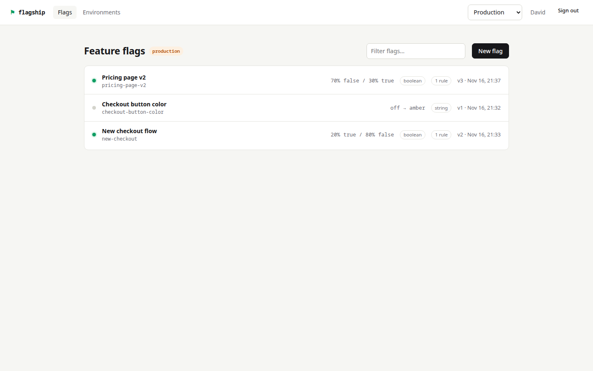
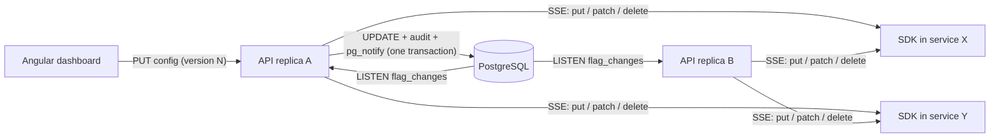
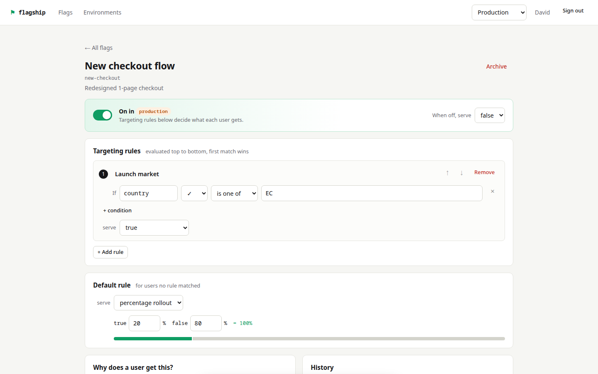

# Flagship

**Feature flags with local evaluation and real-time rollout.** Ship code dark, turn it on for staff, then one country, then 20% of everyone, and kill it in one click if the error rate moves. No redeploys.



| | |
|---|---|
| **Stack** | TypeScript end to end · NestJS 12 · Angular 22 (zoneless, signals) · PostgreSQL 17 · a pure evaluation engine + server SDK |
| **Quality** | Vitest (64 engine + 9 SDK tests, coverage gates) · black-box integration over 2 replicas (9) · Playwright E2E (5) · ESLint · SonarQube · CodeQL · Trivy · gitleaks |
| **Ops** | Prometheus metrics · JSON logs · OpenTelemetry-ready · Docker · GitHub Actions (OIDC) · Terraform · AWS ECS Fargate + RDS |

## Why it's built this way

Homegrown flag systems usually call an API for every `isEnabled()` check. That adds latency to every request and makes the flag service a single point of failure. Flagship works like the commercial products:

1. The **SDK downloads the environment's ruleset once** and keeps it in memory.
2. **Evaluation is local and synchronous** (~1 µs) and keeps serving the last known rules if Flagship is down.
3. **Changes are pushed over a stream** to every connected SDK, across API replicas, through Postgres `LISTEN/NOTIFY`.



## Measured

| What | Result |
|---|---|
| Local evaluation | 10,000 evaluations in 11.4 ms (≈1.1 µs each) |
| Change → SDK on the same replica | 11.7 ms (PUT round trip included) |
| Change on replica A → SDK on replica B | 13.4 ms (also asserted < 1 s in CI) |
| 2,000 SDK streams on one replica | ~80 KB per stream; change reached **all** 2,000 in ≤ 62 ms (p50 51 ms) |

Details and method in [SCALABILITY](docs/SCALABILITY.md).

## Highlights

| | |
|---|---|
| **Deterministic bucketing** | `murmur3(flagKey.salt.userKey)` → 100,000 buckets. Assignments are sticky with nothing stored, raising a rollout only *adds* users, and the per-flag salt keeps flags independent (all tested) |
| **One engine everywhere** | `@flagship/core` is pure, isomorphic TypeScript. The SDK and the dashboard's *"why does this user get this?"* both run it, so they can't disagree |
| **Postgres only** | Cross-replica fan-out via `LISTEN/NOTIFY`. `pg_notify` inside the write transaction is delivered **only if it commits**. A dropped LISTEN connection triggers a full resync |
| **Safe concurrent editing** | Every config is versioned. A stale save gets `409`, so nobody silently overwrites a teammate's kill switch |
| **Resilient SDK** | Streams over `fetch` (works where `EventSource` can't send auth headers), jittered reconnect, rejects out-of-order patches, offline bootstrap, never returns the wrong type |
| **Audit trail, rollback & keys** | Who/what/where with before/after config, one-click restore of any previous state (goes through the normal versioned write path). Per-environment SDK keys stored hashed, shown once, rotated instantly |
| **Ecosystem** | Optionally publishes `flag.*` events to [Hookrelay](https://github.com/DRTX2/hookrelay) (idempotent, after commit, never a dependency). See [ECOSYSTEM](docs/ECOSYSTEM.md) |



## Use the SDK

```ts
import { FlagshipClient } from '@flagship/sdk';

const flags = await FlagshipClient.init({ sdkKey: process.env.FLAGSHIP_SDK_KEY!, baseUrl: 'https://flags.internal' });

if (flags.variation('new-checkout', { key: user.id, country: user.country, plan: user.plan }, false)) {
  return renderNewCheckout();
}
flags.variationDetail('new-checkout', ctx, false); // { value, variationIndex, reason: { kind: 'RULE_MATCH', ruleId } }
flags.onChange((key) => log.info(`flag ${key} changed`));
```

Targeting operators: `is one of`, `contains`, `starts/ends with`, `< ≤ > ≥`, `version ≥/<` (semver), each negatable. Array attributes match on any element. A missing attribute never matches, *even when negated*.

## Run it

```bash
docker compose up -d                  # http://localhost:4000 · admin token: change-me
# Environments → Generate key, then:
cd examples && FLAGSHIP_URL=http://localhost:4000 SDK_KEY=fs_sdk_... ADMIN_TOKEN=change-me node propagation.mjs
```

## Tests

```bash
pnpm --filter @flagship/core test:cov   # 64 tests · 100% lines / 98% branches
pnpm --filter @flagship/sdk test:cov    # 9 tests against a real SSE server · 100% / 96%
pnpm --filter api test:int              # 9 black-box tests: 2 API replicas + real SDK + Postgres + stand-in Hookrelay
pnpm --filter e2e test                  # 5 Playwright flows on the Angular dashboard
```

## Documentation

| Doc | |
|---|---|
| [ARCHITECTURE](docs/ARCHITECTURE.md) | Components, evaluation model, propagation, data model |
| [ADRs](docs/adr) | Local evaluation, LISTEN/NOTIFY, murmur3 bucketing, optimistic concurrency, ECS |
| [IMPLEMENTATION_PLAN](docs/IMPLEMENTATION_PLAN.md) · [ROADMAP](docs/ROADMAP.md) | What's done, what's next |
| [TEST_PLAN](docs/TEST_PLAN.md) | Pyramid, cases, coverage policy, gaps |
| [DEPLOYMENT](docs/DEPLOYMENT.md) | AWS + Terraform + CI/CD, first deploy, rollback, cost |
| [OBSERVABILITY](docs/OBSERVABILITY.md) · [RUNBOOK](docs/RUNBOOK.md) | Signals, SLOs, alerts, what to do |
| [SECURITY](docs/SECURITY.md) | Threat model, OWASP mapping, accepted risks |
| [SCALABILITY](docs/SCALABILITY.md) | Measurements and limits |
| [ECOSYSTEM](docs/ECOSYSTEM.md) | How Flagship and Hookrelay integrate while staying independent |
| [CONTEXT](docs/CONTEXT.md) · [AGENTS.md](AGENTS.md) | Project memory and conventions for continuing work |

## Layout

```
packages/core      evaluation engine (pure TS, zero deps)
packages/sdk       server SDK (streaming, local eval)
apps/api           NestJS 12: management API, SDK endpoints, SSE, LISTEN/NOTIFY, serves the dashboard
apps/dashboard     Angular 22: zoneless, signals, httpResource, lazy routes
e2e/               Playwright suite (boots the real API + dashboard)
examples/          propagation benchmark
infra/terraform    AWS: VPC, ECS Fargate, ALB, RDS, Secrets Manager, alarms, OIDC roles
.github/workflows  CI, CodeQL, deploy
```

## License
MIT. Built by [David Manjarres](https://drtx2.github.io/portfolio/).
