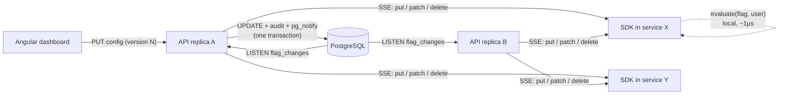

# Flagship

**Feature flags with local evaluation and real-time rollout.** Ship code dark, turn it on for staff, then Ecuador, then 20 % of everyone, and kill it in one click if the error rate moves. No redeploys.


## Why it's built this way

Most homegrown flag systems call an API for every `isEnabled()` check. That adds latency to every request and turns the flag service into a single point of failure. Flagship works like the commercial products do:

1. The **SDK downloads the environment's ruleset once** and keeps it in memory.
2. **Evaluation is local and synchronous**: about 1 µs, no network, and it keeps serving the last known rules if Flagship goes down.
3. **Changes are pushed over a stream** and reach every connected SDK in about 13 ms, including across API replicas.



## What's interesting

| | |
|---|---|
| **Deterministic bucketing** | `murmur3(flagKey.salt.userKey)` mapped to 100,000 buckets. The same user always gets the same variation with no stored assignments. Raising a rollout from 20 % to 50 % only *adds* users and never reshuffles who already had it (tested). The per-flag salt keeps flags independent, so the same users aren't always the first 20 %. |
| **One engine everywhere** | `@flagship/core` is pure, isomorphic TypeScript. The SDK, the API's *"why does this user get this?"* endpoint and any future browser SDK run identical code, so the dashboard can't disagree with production. |
| **Postgres only** | Cross-replica fan-out uses `LISTEN/NOTIFY` instead of adding Redis. `pg_notify` inside the write transaction is only delivered **if the transaction commits**, so SDKs can never see a change that was rolled back. If the LISTEN connection drops, every SDK on that replica gets a full `put` to resync. |
| **Safe concurrent editing** | Every config has a `version`. Saving a stale draft returns `409` ("changed by someone else"), so nobody silently overwrites a teammate's kill switch. `SELECT … FOR UPDATE` serializes writers. |
| **Resilient SDK** | Streams over `fetch` (works in Node and browsers, unlike `EventSource` which can't send auth headers). Reconnects with exponential backoff + full jitter, ignores out-of-order patches by version, supports `bootstrap` flags for offline starts, never returns a value of the wrong type, and stops retrying on a revoked key. |
| **Audit trail** | Every change records who, what, where and the before/after config. |
| **SDK keys** | Per environment, stored as SHA-256, shown once, rotated in one click (the old key dies immediately). |

## Targeting

Rules are evaluated top to bottom; the first match wins. Each rule ANDs conditions over any user attribute:

`is one of` · `contains` · `starts with` · `ends with` · `< ≤ > ≥` · `version ≥ / <` (semver, for mobile app versions), each negatable. Array attributes match if any element matches (`groups: ["beta", "staff"]`). A missing attribute never matches, *even when negated*: "country is not US" won't silently include users whose country is unknown.

A rule (or the default) serves either a fixed variation or a percentage rollout, optionally bucketed by another attribute (`bucketBy: "orgId"` gives a whole company the same experience).


## Use the SDK

```ts
import { FlagshipClient } from '@flagship/sdk';

const flags = await FlagshipClient.init({ sdkKey: process.env.FLAGSHIP_SDK_KEY!, baseUrl: 'https://flags.internal' });

if (flags.variation('new-checkout', { key: user.id, country: user.country, plan: user.plan }, false)) {
  return renderNewCheckout();
}

flags.variationDetail('new-checkout', ctx, false);
// { value: true, variationIndex: 1, reason: { kind: 'RULE_MATCH', ruleIndex: 0, ruleId: 'ecuador' } }

flags.onChange((key) => log.info(`flag ${key} changed`));
```

`examples/propagation.mjs` measures it against a running server:

```
before: 0 of 10000 users see new-checkout
propagated to SDK in 11.7 ms (PUT round-trip included)
after: 4028 of 10000 users (EC rule + 20% rollout), evaluated in 11.4 ms
```

Cross-replica (write on replica A, SDK connected to replica B): **13.4 ms**.

## Run it

```bash
docker compose up -d          # http://localhost:4000, admin token: change-me
# Environments → Generate key, then:
cd examples && FLAGSHIP_URL=http://localhost:4000 SDK_KEY=fs_sdk_... ADMIN_TOKEN=change-me node propagation.mjs
```

Dev: `pnpm i && pnpm build`, run Postgres, `pnpm dev:api` (port 4000) and `pnpm dev:dashboard` (port 4200, proxies `/api`).

## Tests

```bash
pnpm test
```

- **core (21)**: MurmurHash3 reference vectors, stickiness, 25/75 distribution over 10k users, monotonic rollouts, salt independence, `bucketBy`, every operator, semver, negation with missing attributes, validation.
- **sdk (5)**: against a real SSE server: patch ordering, stale patch rejection, delete, reconnect + resync after a dropped stream, bootstrap when offline, type safety, revoked key.
- **End to end** (scripted with Playwright against the real stack): login, create flag, add rule + 70/30 rollout, save, audit entry, explain, and a concurrent-edit `409`.

## Layout

```
packages/core      evaluation engine (pure TS, zero deps)
packages/sdk       server SDK (streaming, local eval)
apps/api           NestJS 12: management API, SDK endpoints, SSE, LISTEN/NOTIFY
apps/dashboard     Angular 22: zoneless, signals, httpResource, lazy routes
examples/          propagation benchmark
```

## Trade-offs and next steps

- Dashboard auth is a shared admin token plus a self-declared name for the audit log. Real deployments need SSO with per-user roles and per-environment permissions (e.g. only leads can touch production).
- Variations are immutable after creation because rules reference them by index. Editing them safely needs a migration step.
- No experiment analytics yet. The SDK already returns the `bucket` and `reason` needed to emit exposure events.
- No scheduled changes or flag prerequisites yet.
