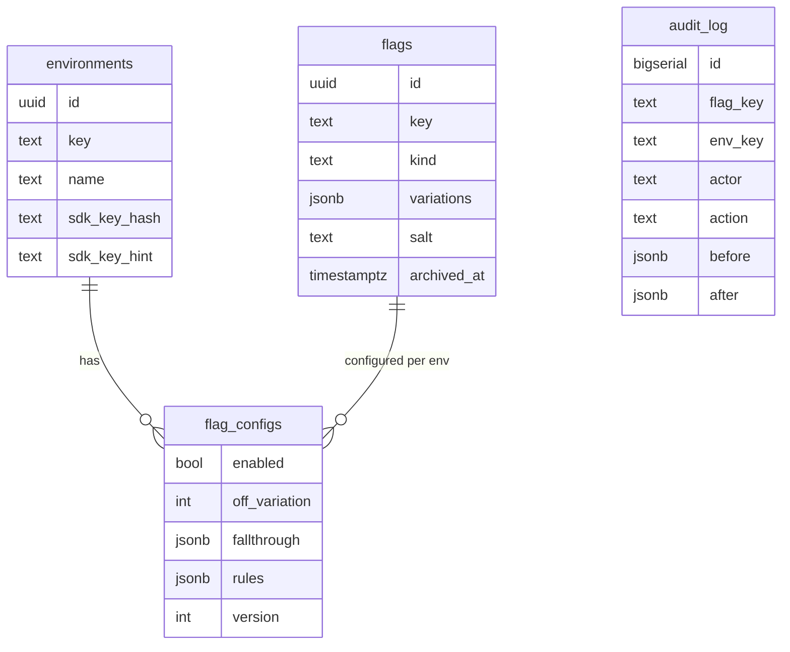

# Architecture

## Components

| Component | Tech | Responsibility |
|---|---|---|
| `packages/core` | Pure TypeScript, zero deps | `evaluate(flag, context)`, `bucket()`, `validateFlag()`. Isomorphic (Node, browser, edge) |
| `packages/sdk` | TypeScript, `fetch` streaming | Keeps a ruleset in memory, applies `put/patch/delete`, evaluates locally |
| `apps/api` | NestJS 12 | Management API (`/api`, admin token), SDK API (`/sdk/v1`, SDK key), SSE, LISTEN/NOTIFY, serves the dashboard |
| `apps/dashboard` | Angular 22 (zoneless, signals) | Flags, targeting editor, rollout, explain sandbox, audit, environments/keys |
| PostgreSQL | RDS | Flags, per-environment configs, audit log, and the change bus (`NOTIFY`) |

There's no Redis and no queue on purpose ([ADR-0002](adr/0002-postgres-listen-notify.md)).

## Evaluation model

```
flag (per environment)
├─ enabled? ── no ──▶ offVariation                         reason: OFF
├─ rules[] (first match wins; clauses AND'ed)
│   └─ match ──▶ serve: variation | rollout(bucketBy)      reason: RULE_MATCH(ruleId)
└─ fallthrough ──▶ serve: variation | rollout              reason: FALLTHROUGH
```

- **Bucketing:** `floor(murmur3("flagKey.salt.value") / 2^32 × 100000)`. Weights are in thousandths of a percent and must sum to 100,000. Iterating weights in order makes growth monotonic: going from 20% to 50% keeps everyone who was already in ([ADR-0003](adr/0003-murmur3-bucketing.md)).
- **Missing attributes never match**, even negated. "country not in [US]" must not include users whose country is unknown.
- **Variations are immutable** after creation because rules reference them by index.

## Propagation

```mermaid
sequenceDiagram
  participant UI as Dashboard
  participant A as API replica A
  participant DB as Postgres
  participant B as API replica B
  participant S as SDK (connected to B)
  S->>B: GET /sdk/v1/stream (SDK key)
  B-->>S: event: put (full ruleset)
  UI->>A: PUT /api/flags/:key/envs/:env { …, version: 7 }
  A->>DB: BEGIN; SELECT … FOR UPDATE; version check; UPDATE; INSERT audit; pg_notify; COMMIT
  DB-->>A: NOTIFY flag_changes {env, key}
  DB-->>B: NOTIFY flag_changes {env, key}
  B->>DB: load flag config
  B-->>S: event: patch { flag v8 }
  S->>S: ignore if version ≤ current; swap; emit onChange
```

- The notification is sent **inside** the write transaction, so SDKs never see a rolled-back change.
- Each replica holds **one** LISTEN connection and fans out to its own SSE clients (RxJS `Subject` filtered by environment).
- If the LISTEN connection drops, the replica reconnects and pushes a full `put` to all of its streams, since any notification sent in between is lost.
- SDK reconnects (deploys, scale-in) always start with a full `put`, so there's no gap to reconcile.

## Concurrency control
`flag_configs.version` + `SELECT … FOR UPDATE`. The editor sends the version it started from. A mismatch returns `409 Conflict` and the UI asks the user to reload ([ADR-0004](adr/0004-optimistic-concurrency.md)).

## Data model



## Security boundaries
- `/api/*`: admin token (constant-time compare) plus `x-actor` for the audit log. A shortcut until SSO ([SECURITY](SECURITY.md)).
- `/sdk/v1/*`: SDK key → exactly one environment. Keys stored as SHA-256.
- Dashboard served from the same origin with a strict CSP (`script-src 'self'`).

## Deployment view
One container image (API + built dashboard) on ECS Fargate behind an ALB, with RDS PostgreSQL. See [DEPLOYMENT](DEPLOYMENT.md).
