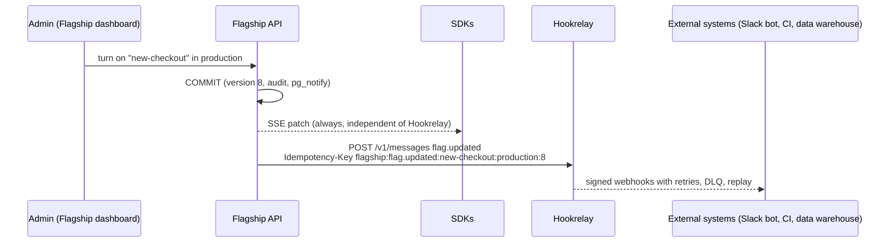

# Ecosystem: Flagship + Hookrelay (+ Nimbus)

> The three products run together as **Atalaya** ([DRTX2/atalaya](https://github.com/DRTX2/atalaya)): Nimbus detects a failing pipeline, calls `POST /automation/nimbus/flags/:key/envs/:env` here (HMAC-signed) to kill a flag, and restores it on recovery if no human changed it meanwhile. See that repo for the asserted end-to-end demo.

Two **independent products** that solve different problems and can be used together:

| | Flagship | Hookrelay |
|---|---|---|
| Problem | Control who gets which behaviour, changed live | Deliver events between systems reliably |
| Core | Evaluation engine + streaming SDK | Delivery engine with retries, DLQ, replay |
| State | PostgreSQL (configs, audit, NOTIFY bus) | PostgreSQL (source of truth) + Redis (queue) |
| Deploys | Own repo, image, database, pipeline | Own repo, image, database, pipeline |

## The integration (implemented, optional)



- Enabled by setting `HOOKRELAY_URL` + `HOOKRELAY_API_KEY` on Flagship. Unset means the integration is off.
- Events: `flag.created`, `flag.updated` (incl. `rolled back to #id`), `flag.archived`, with flag key, environment, version, action and actor.
- **Flagship never depends on Hookrelay**: publishing happens after COMMIT, fire-and-forget with a 3 s timeout, counted in `flagship_hookrelay_notifications_total{result}`. SDK propagation doesn't touch it.
- **Exactly-once effect** at the Hookrelay boundary: the idempotency key is derived from `(type, flag, env, version)`, so a retried publish never creates a second message.
- Verified by Flagship's integration suite against a stand-in Hookrelay (auth header, idempotency key, payload). Decision record: [ADR-0006](adr/0006-optional-hookrelay-integration.md).

## What is deliberately *not* shared (yet)
A shared platform layer (single sign-on, organizations, RBAC, billing) would be the next step if these became one commercial offering. It isn't built because:
1. It's generic work that doesn't change either product's core value.
2. Coupling auth/billing early would make the products harder to deploy and reason about independently.

If it's ever built, it should be a separate identity service (OIDC) that both products trust, not a merged codebase. See ROADMAP items "SSO + roles" in both repos.

## Running both together locally
```bash
# Hookrelay (port 3000) — create a tenant and copy its API key
cd hookrelay && docker compose up -d && curl -s -XPOST localhost:3000/v1/apps -H 'x-admin-token: change-me' -H 'content-type: application/json' -d '{"name":"flagship"}'
# Flagship (port 4000) — point it at Hookrelay
cd flagship && HOOKRELAY_URL=http://host.docker.internal:3000 HOOKRELAY_API_KEY=hr_... docker compose up -d
# Register any endpoint in Hookrelay for "flag.updated" and toggle a flag in Flagship.
```
